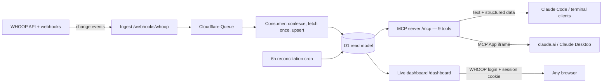
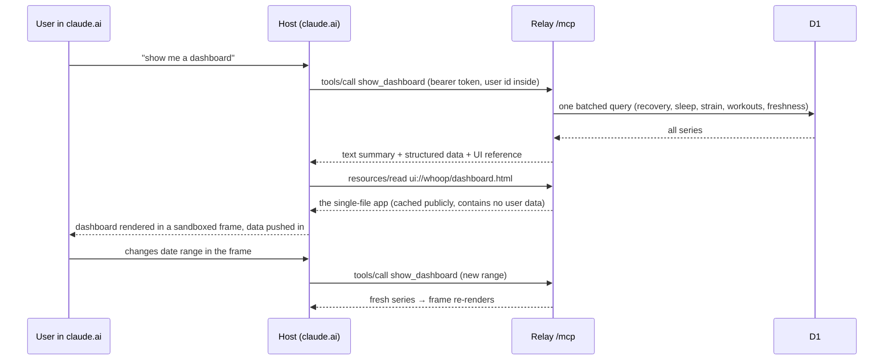
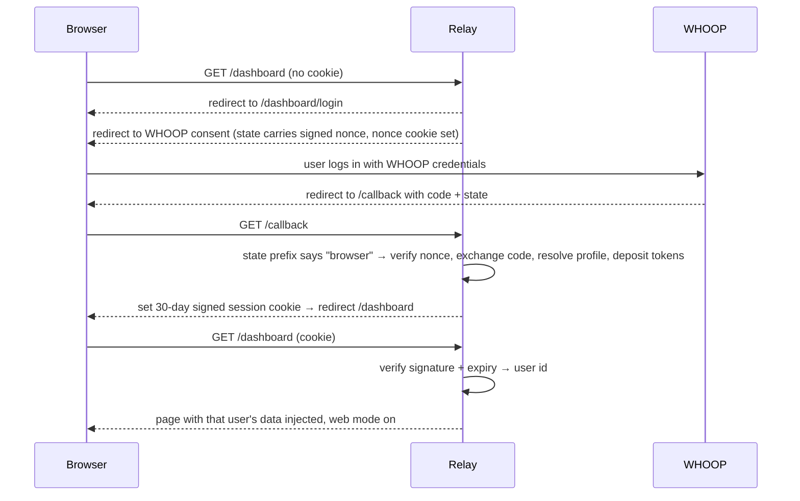

# WHOOP Relay Architecture

**PromptMetrics · Engineering handover · 2026-08-26**

WHOOP Relay is an orchestration layer that turns one WHOOP developer app into a multi-user data service for Claude: near-real-time health data served through a remote MCP server, an interactive dashboard rendered inside the chat, and an authenticated live dashboard on the web — all on one Cloudflare Worker at `whoop.promptmetrics.dev`.

This document records every architectural decision, why each was taken, one decision that was reversed within a day (and why that reversal matters), and the final architecture in detail. Written for the documentation team; assumes a technical operator reader, not a programmer.

A rendered version with the same content lives as a Claude artifact (private, shareable): `https://claude.ai/code/artifact/9ddf663b-e3f8-4aa3-85ba-28466bae4345`

---

## 1 · The system at a glance

The business problem: WHOOP grants one developer app a shared budget of 100 API calls per minute and 10,000 per day, and every user question ("how did I sleep this month?") would otherwise burn paginated live calls against it. The relay inverts this. WHOOP pushes change notifications; the relay pulls each changed record once, stores it in its own database, and every question from a Claude client is answered from that local copy — in SQL, in milliseconds, at zero API cost. The API budget is spent on staying current, not on answering questions.

Four surfaces sit on the same Worker and the same data:

| Surface | Who uses it | What it delivers |
|---|---|---|
| MCP tools (9) | Any Claude client | Recovery, sleep, strain, workouts, trends, daily report — answered from D1, no API quota spent |
| In-chat dashboard | claude.ai, Claude Desktop | `show_dashboard` renders an interactive charts-and-filters app inside the conversation (MCP Apps) |
| Live web dashboard | Any browser | `/dashboard` — one URL for every user, WHOOP login, each person sees only their own data |
| Webhook pipeline | WHOOP (machine-to-machine) | Keeps D1 current within seconds of WHOOP processing a night's sleep |

## 2 · Decision record — data pipeline & MCP core

Each entry: the decision, why it was taken, and what it costs or constrains. These were made during the initial build (2026-08-26, morning session).

### D-01 · D1-first read model: webhooks fill a local database, tools read only from it

- **Why:** WHOOP's rate limits are per app, shared across all users. Serving questions from live API calls would let one curious user starve everyone. With a local read model, trend questions become SQL and cost nothing; the API budget goes exclusively to ingestion.
- **Trade-off:** Data is eventually consistent. Recovery and sleep arrive within seconds (webhook-driven); day strain lags because WHOOP sends no webhooks for it (see D-08). Tool descriptions state this staleness explicitly so the model sets user expectations.

### D-02 · Everything on one Cloudflare Worker: Queues, D1, Durable Objects, custom domain

- **Why:** One deployable, one bill, zero servers to patch. The pieces map cleanly: Queues absorb webhook bursts, D1 is the read model, Durable Objects hold the two pieces of state that must be single-writer (D-05, D-06). This is also the same skeleton PromptMetrics uses for client builds — the repo doubles as the demoable reference for the pattern.
- **Trade-off:** Cloudflare-specific APIs throughout; porting means rework. Accepted deliberately.

### D-03 · MCP specification 2026-07-28, adopted fully and stateless

- **Why:** The 2026-07-28 revision moved MCP from stateful sessions to plain stateless HTTP — a fresh server object is built per request, so any request can land on any Worker instance with no session affinity. The relay adopts the whole revision: required cache hints on list responses (`tools/list` is cached publicly for 1 hour), MRTR for mid-call questions (D-07), and CIMD for client registration with the old DCR endpoint kept as a 12-month fallback. Decisions were verified against the official changelog, not the announcement post.
- **Trade-off:** The 1-hour public cache on the tool list means newly deployed tools can take up to an hour to appear in already-connected clients — harmless, but it surprises people during rollouts.

### D-04 · Official v2 MCP SDK directly; the Cloudflare `agents` wrapper was dropped

- **Why:** The wrapper adds a thin routing layer but fixes auth context at startup, while per-user identity here must flow per request (each request carries a different user's decrypted properties). The v2 SDK's own request handler takes a factory function, so identity flows naturally. Fewer layers, same behavior. Note for anyone touching this code: v2 (`@modelcontextprotocol/server`) is a different package with substantially different APIs than the legacy v1 `@modelcontextprotocol/sdk`.

### D-05 · TokenManager Durable Object: exactly one refresher per user's WHOOP tokens

- **Why:** WHOOP rotates refresh tokens on every use. If two code paths refreshed independently, the second would invalidate the pair and silently log the user out. The Durable Object gives a per-user single writer — the only code in the system allowed to touch WHOOP's token endpoint. Browser logins and MCP consents both deposit tokens into it rather than holding their own.

### D-06 · RateBudget Durable Object with two lanes: bulk and interactive

- **Why:** One global instance enforces WHOOP's per-app limits before any API call is made: 95/minute shared; bulk work (queue, cron, backfill) capped at 8,500/day; interactive work (a user clicking "sync now", a new connection) allowed up to 9,500; a 500-call final buffer. The lanes exist so a six-month history backfill can never starve a live user interaction.

### D-07 · MRTR used in exactly one place: `sync_now` under budget exhaustion

- **Why:** MRTR is the 2026-07-28 mechanism for a tool to ask the user a question mid-call. When the API budget is spent, `sync_now` asks "proceed with cached data?" instead of failing. Every other tool stays single-shot deliberately — mid-call interaction is friction, and only this one case earns it.

### D-08 · WHOOP's quirks are encoded as invariants, not worked around case-by-case

- **Why:** Webhooks carry no data — they are dirty flags, unordered and unguaranteed, so every write is an idempotent upsert keyed by resource id and deletions tombstone locally with no API call. Recovery events carry the *sleep* id, not a recovery id — resolved by scanning the recent recovery collection. Day strain has no webhooks at all — freshness comes from piggybacking on recovery events, a 6-hour reconciliation cron, and `sync_now`. The reconciliation watermark re-reads a 2-day overlap window because WHOOP collections filter on activity start time, not update time, so backdated edits get caught. Cycle ids are integers while sleep and workout ids are UUIDs — the columns are typed differently on purpose and must never be unified.

### D-09 · WHOOP is the upstream identity provider — one consent screen does two jobs

- **Why:** Connecting from a Claude client triggers one WHOOP login that simultaneously authorizes the MCP client and links the WHOOP account. The user's WHOOP id is sealed (encrypted) into the MCP access token at consent time and decrypted on every request — no lookup table, no separate account system. Onboarding an Operator Stack member is a single link.
- **Trade-off:** The OAuth state parameter carries the downstream request as encoded JSON (the standard Cloudflare pattern); signing it is a known, accepted future hardening item.

## 3 · Decision record — the dashboard

Built the same day, prompted by: "the user should get a UI dashboard generated on the fly when they ask the MCP to create it — beautiful and insightful charts, trends, analysis and filters."

### D-10 · MCP Apps (SEP-1865) for in-chat rendering, not a link to an external page

- **Why:** MCP Apps is the official MCP extension (final January 2026) that lets a tool ship an interactive HTML app rendered in a sandboxed frame inside the conversation — supported by claude.ai, Claude Desktop, and others. The dashboard lives where the discussion happens: the user asks a question, the dashboard appears under it, and interactions inside the frame can call the server's tools over the already-authenticated connection. No second login, no tab-switching, no separate API to build.
- **Trade-off:** Terminal clients don't render frames. Every tool result therefore carries a self-sufficient text summary plus structured data any coding agent can chart from — degradation is designed, not accidental.

### D-11 · One HTML template serves every surface, with a mode switch at boot

- **Why:** The dashboard is a single self-contained HTML file (all scripts and styles inlined, ~527 KB) built once and embedded in the Worker. At load it detects its situation: data pushed by an MCP host → **live mode** (range changes re-query through the host); data injected server-side with a web flag → **web mode** (range changes navigate the URL); injected data without the flag → **static snapshot**; nothing at all → **demo mode** with synthetic data so anyone can preview it in a plain browser. One build artifact, zero duplication, and the strict frame sandbox (which blocks all external scripts and fonts) is satisfied by construction.

### D-12 · One `show_dashboard` tool returns all series; filters run client-side

- **Why:** The tool returns every chart series for the range in one database round trip (a single batched query). Metric toggles, the sport filter, and panel visibility operate instantly on data already in the frame; only a date-range change re-queries. This means one host permission prompt instead of one per interaction, and no per-click latency.
- **Why not call the existing granular tools from the frame?** They return differently shaped payloads and would need four or five calls per filter change — and some hosts prompt the user on every call.

### D-13 · The `panels` parameter gives both composition modes

- **Why:** A user decision: support both "one smart dashboard" and "model-composed layouts." Omitting `panels` renders the full six-panel dashboard; asking Claude for "just sleep vs recovery for June" makes it pass a subset, and only those panels render. Same template, same data path — the parameter is a display instruction, so the model composes freely without any layout edge cases server-side.

### D-14 · Chart.js, tree-shaken, with hard visualization rules from the studio dataviz method

- **Why:** Chart.js delivers mixed bars/lines, stacks, and scatters natively at ~180 KB when only the needed pieces are registered; date labels ride a plain category axis, saving a 40 KB date library. The visualization method imposed real constraints: **no dual-axis charts anywhere** (HRV/RHR and strain-vs-recovery became stacked small multiples instead), WHOOP's recovery bands use a reserved status palette (green/yellow/red are states, never series colors), a validated color palette with dark and light variants, and an expandable data table under every chart as the accessibility fallback.

### D-15 · The MCP Apps client library is bundled into the frame only; the server side is hand-rolled

- **Why:** The extension's server helpers target the legacy v1 SDK, but they are thin wrappers: the v2 SDK passes the required metadata through natively. So the tool declares both the current key (`_meta.ui.resourceUri`) and the legacy compatibility key, the template resource uses the exact official media type (`text/html;profile=mcp-app`, read from the installed package rather than guessed), and no extra server dependency exists. All of this was verified against installed type definitions before any code was written — the same discipline that earlier caught the real v2 API shapes.

## 4 · The reversal: link sharing out, authenticated page in

This is the most instructive sequence in the project, and the documentation should tell it honestly: a feature shipped in the morning was removed by the afternoon, for a good reason, and its replacement is better.

### D-16 · Shareable snapshot links (`share=true` → expiring unlisted URL) — **REVERSED SAME DAY**

- **What it was:** The dashboard tool could publish a read-only data snapshot to an unguessable, expiring URL (128-bit token in the path, 30-day default expiry, no listing endpoint, no-index headers) — the standard capability-URL pattern.
- **Why it was reversed:** First real-world use: a Claude session's permission classifier **blocked the call**, correctly characterizing it as publishing health data to a public URL. The mechanism was defensible, but the framing was fatal — any tool whose common path *can* publish sensitive data inherits that suspicion on every call. The lesson generalizes to every connector PromptMetrics builds: *keep read paths pure and make publish paths separate, explicit, and consented — or don't build them.*
- **What replaced it:** Three options were evaluated with the user: (A) render to a local HTML file — zero exposure, terminal-friendly; (B) a separate share tool with in-protocol consent; (C) an authenticated live page. The user chose C alone, and all sharing infrastructure was removed the same day: the snapshot route now returns 404, the storage binding is gone, and `show_dashboard` is annotated read-only (`readOnlyHint`) with nothing left for a classifier to object to.

### D-17 · Authenticated live dashboard: one URL, per-user data, nothing published

- **Why:** Every user opens the same address — `whoop.promptmetrics.dev/dashboard`. A WHOOP login issues a signed 30-day session cookie; the page derives identity *only* from that verified cookie, never from the URL, and every database query is already scoped to the user id. Nobody without the login sees anything; nothing exists to leak. Terminal clients get this URL in the tool's text fallback, which also resolves the "terminal can't render frames" gap: the browser is the renderer.
- **Session mechanics:** The cookie is an HMAC-signed value (user id + expiry + signature) — tamper-evident, no server-side session storage. It is HttpOnly (page scripts can't read it), Secure (HTTPS only), and SameSite (blocks cross-site riding). The signing key is a Worker secret (`SESSION_SECRET`). Login-CSRF is blocked by a signed nonce that must round-trip through both the OAuth state and a short-lived cookie.
- **Callback multiplexing:** WHOOP allows one registered redirect URL, which the MCP consent flow already uses. Browser logins share it: their state values carry a distinguishing prefix (`b.`), MCP states are encoded JSON blobs, and the callback branches on the prefix. The shared middle — token exchange, budget draw, profile fetch, token deposit, user upsert — was extracted into one function both flows call. A side improvement landed here: the six-month history backfill now runs only for first-time users, so repeat logins stop re-spending API budget.

### D-18 · The page's security policy lives in a meta tag, not a header

- **Why:** The first real login showed an empty dashboard. Root cause: the promptmetrics.dev zone auto-injects Cloudflare analytics scripts into HTML responses *and rewrites the Content-Security-Policy header* to whitelist its own beacon — which, per the CSP specification, disables the allowance our inlined app relied on. The entire dashboard script was silently blocked. The fix moves the policy into a meta tag inside the HTML, which the edge does not rewrite. Bonus: the injected third-party analytics scripts are now the ones being blocked — the correct outcome on a health-data page. This gotcha applies to **any** inline-script HTML served through this zone.

## 5 · Final architecture in detail

### 5.1 · Ingestion: how data gets in and stays current

WHOOP posts a webhook when something changes (a sleep processed, a workout edited). The ingest handler verifies the signature against the raw body, deduplicates on the event's trace id, drops the event on a queue, and answers immediately — it never calls the WHOOP API itself. The queue consumer takes batches, coalesces duplicate events for the same record keeping only the newest, draws permission from the RateBudget (bulk lane), fetches each changed record once from WHOOP, and upserts it into D1. Deletions tombstone the local row without any API call. A reconciliation cron runs every six hours and closes any gaps webhooks missed, using per-resource watermarks with a two-day overlap; a nightly cron checks token health. New users get a six-month history backfill enqueued as low-priority bulk work at first connection.

### 5.2 · The MCP surface

| Tool | What it answers | Notes |
|---|---|---|
| `get_recovery` | Daily recovery, HRV, resting HR, SpO2, skin temp | Near-real-time |
| `get_sleep` | Sleep sessions with stage breakdown and performance | Near-real-time |
| `get_workouts` | Workouts with strain, energy, heart-rate zones | Sport filter |
| `get_strain` | Daily cycle strain and energy | Lags real time by design (D-08) |
| `get_profile` | Name, email, body measurements | |
| `daily_report` | One day composed: recovery + sleep + strain + workouts | |
| `trend` | Rolling trend for one metric with window averages and deltas | Pure SQL, zero quota |
| `sync_now` | Force a live WHOOP fetch | The only tool that spends API budget; asks before degrading (D-07) |
| `show_dashboard` | The interactive dashboard (or its data + web URL as fallback) | Read-only annotated; `panels`, date range, granularity |

### 5.3 · The dashboard app

Six panels: stat tiles with deltas against the previous equal-length window; recovery bars colored by WHOOP band with a 7-day average line; HRV and resting-heart-rate small multiples; sleep-stage stacks with a performance strip; day strain against next-morning recovery, including a scatter ("did I earn that red day?"); and workouts — a sortable table plus strain-by-sport bars. A footer shows per-resource data freshness and the strain-staleness caveat. Filters: date presets (7/30/90 days) and custom range, sport dropdown, per-panel toggles, and an expandable data table under every chart. The template itself contains zero user data — that is what makes it safe to cache publicly for an hour; per-user data arrives only through tool results or server-side injection.

### 5.4 · The browser login

### 5.5 · Routes, data, files

| Route | Auth | Purpose |
|---|---|---|
| `POST /mcp` | OAuth bearer token | All MCP traffic; user id decrypted from the token per request |
| `POST /webhooks/whoop` | HMAC signature | Event ingest; unsigned requests rejected |
| `/authorize, /callback, /token, /register` | OAuth machinery | MCP consent flow; `/callback` is shared with browser logins (D-17) |
| `GET /dashboard` | Session cookie | Live per-user dashboard; no cookie → login redirect |
| `GET /dashboard/login · /logout` | — | Start WHOOP login; clear session |
| `GET /` | — | Plain-text landing naming the endpoints |

| Table | Key | Holds |
|---|---|---|
| users | WHOOP user id | Identity, connection status |
| recoveries | sleep id | Score, HRV, resting HR, SpO2, skin temp (WHOOP v2 keys recovery by its sleep) |
| sleeps | UUID | Stages, performance, respiratory rate |
| cycles | integer id | Day strain, energy, heart rates |
| workouts | UUID | Sport, strain, energy, HR zones |
| webhook_events | trace id | Dedupe and audit |
| sync_state | user + resource | Reconciliation watermarks; feeds the dashboard freshness footer |

| Area | Files | Responsibility |
|---|---|---|
| Entry & auth | `src/index.ts`, `src/mcp/auth.ts`, `src/session.ts` | OAuth provider wrapping the Worker; routing; both login flows; cookie signing |
| Pipeline | `src/ingest.ts`, `src/consumer.ts`, `src/reconcile.ts` | Webhook verify + enqueue; coalesce + fetch + upsert; cron reconciliation |
| State invariants | `src/do/token-manager.ts`, `src/do/rate-budget.ts` | The two Durable Objects (D-05, D-06) |
| MCP | `src/mcp/server.ts`, `src/mcp/dashboard.ts`, `src/mcp/dashboard-data.ts`, `src/mcp/dashboard-types.ts` | Tool registry; dashboard tool + template resource; the batched query and text summary; shared types |
| Web page | `src/dashboard-page.ts` | Cookie check, query params, data injection, meta CSP (D-18) |
| Dashboard app | `ui/` (own build) | Vite single-file build → embedded in the Worker as text at deploy time; never checked into git |

### 5.6 · Security model in one place

- **MCP:** bearer tokens issued by the Worker's own OAuth provider; the user id is sealed into the token at consent and decrypted per request — tools physically cannot query another user's rows.
- **Web:** identity only from the verified HMAC cookie; forging one requires the server secret; pages ship no-store, no-index, no-referrer, and a meta CSP that blocks all external scripts.
- **Webhooks:** HMAC-verified against the raw body; unsigned → 401.
- **Secrets:** `WHOOP_CLIENT_ID`, `WHOOP_CLIENT_SECRET`, `COOKIE_ENCRYPTION_KEY`, `SESSION_SECRET` — all Worker secrets, never in the repo; local dev uses `.dev.vars` (git-ignored, read-blocked for coding agents via repo settings).
- **Nothing publishable:** since D-16's reversal there is no route that serves health data without authentication.

## 6 · Operations

- `npm run typecheck` — the only verification gate; there is no test suite yet (a deliberate v1 gap, see §7).
- `npm run dev` / `npm run deploy` — both build the dashboard app first via pre-hooks; if the npm wrapper is blocked in an agent session, `npx wrangler deploy` works.
- `npm run db:migrate:local|remote` — the schema file is idempotent; additive changes just re-run it.
- `npx wrangler tail` — production logs.
- Deploys occasionally hit a transient Cloudflare API error on queue-consumer triggers; the deploy is idempotent — run it again.
- Crons: reconciliation every 6 hours; token health nightly at 03:30 UTC.

## 7 · Known limits and open items

- **10-user cap** until WHOOP approves the app (approvals reportedly take months). Submit approval + rate-limit increase after the exit tests.
- **No test suite** — typecheck plus scripted wire-level verification harnesses were used during development; a real suite is future work.
- **OAuth state hardening** (signing the MCP flow's state parameter) — accepted for v1, parked.
- **MCP-connect regression check** after the callback refactor — the branch logic is tested, but a real client reconnect should confirm it.
- **Range changes on the web dashboard reload the page** — deliberate (no JSON API surface to secure); revisit only if it feels slow.
- **Orphaned KV namespace** from the removed sharing feature still exists in the Cloudflare account — unused, safe to delete manually.
- **Parked ideas:** a public playbook write-up of the webhook→queue→read-model pattern; a Cloudflare WAF rule keyed on the per-tool routing header; a standalone product domain if this graduates beyond Operator Stack.

---

The one-sentence version for any future contributor: **webhooks fill a local database, tools and dashboards read only from it, two Durable Objects guard the only dangerous state, identity is sealed into tokens and cookies rather than looked up, and nothing serves health data without authentication.**
