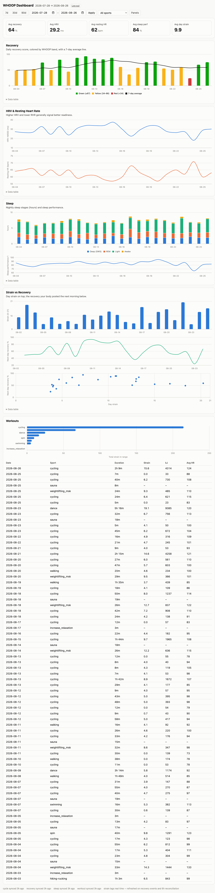
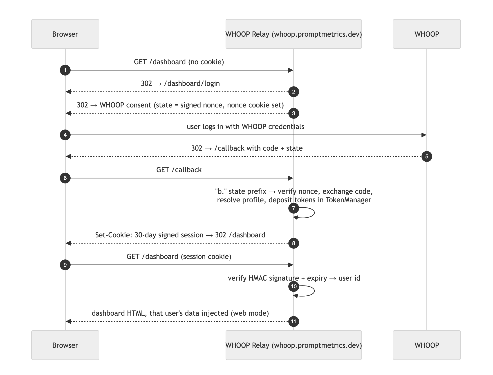

# WHOOP Relay — UX overview

WHOOP Relay has two user-facing surfaces, both rendered by the same single-file HTML dashboard app:

1. **In-chat dashboard (MCP Apps).** In hosts that support MCP Apps (claude.ai, Claude Desktop), the `show_dashboard` tool renders the interactive dashboard directly inside the conversation. Users ask in natural language — "show my WHOOP dashboard", "just sleep vs recovery for June" — and get the full dashboard or a filtered subset of panels. Terminal hosts (Claude Code) receive a text summary plus structured data instead.
2. **Authenticated web dashboard.** `https://whoop.promptmetrics.dev/dashboard` — one URL for every user. First visit redirects to the WHOOP OAuth login; afterwards a signed session cookie loads only the authenticated user's data. There are no share links; every route that serves health data requires authentication.

## Dashboard

Recovery bands with a 7-day average, HRV and resting-heart-rate trends, sleep stages and performance, day strain vs next-day recovery, and a workout log — with date-range, sport, and panel filters. Each chart has an expandable data table.

Every surface that shows WHOOP data carries the "DATA BY WHOOP" attribution and uses WHOOP's palette for WHOOP's own scores (recovery bands, strain, sleep). The web dashboard footer links to the privacy policy and support page and has a **Disconnect WHOOP & delete my data** button; the same action exists as the `disconnect_whoop` tool in Claude. Disconnecting deletes everything immediately.

Connecting is invite-only. A first-time login whose WHOOP email is not on the allowlist becomes an access request: the person sees a "Request received" page, the WHOOP access they just granted is revoked again, and only their name and email are kept. The operator approves or denies from a one-click email link or the `/admin` queue; approval emails the connect steps and the person then connects from Claude as a normal login.

## How data flows

WHOOP webhooks feed a queue → consumer → D1 read model, so user questions are answered from the datastore rather than per-question API calls. Rate limits are enforced by a global budget before every WHOOP API call.

## More

- [README](../README.md) — connecting from Claude clients, tool list, setup
- [ARCHITECTURE.md](ARCHITECTURE.md) — full decision record: rate-limit design, token handling, auth flows
